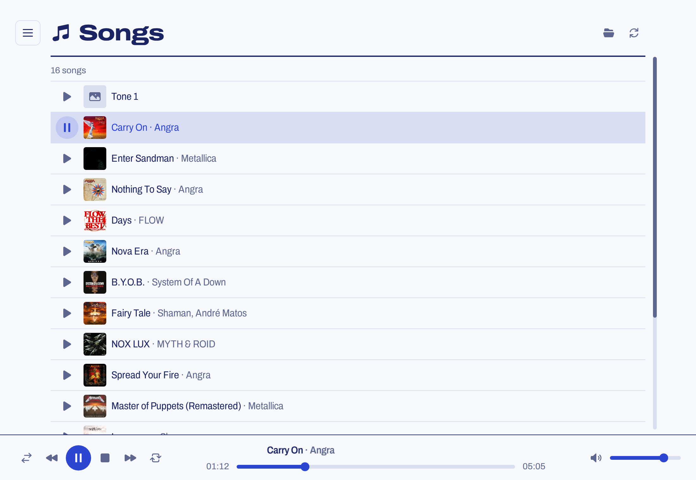
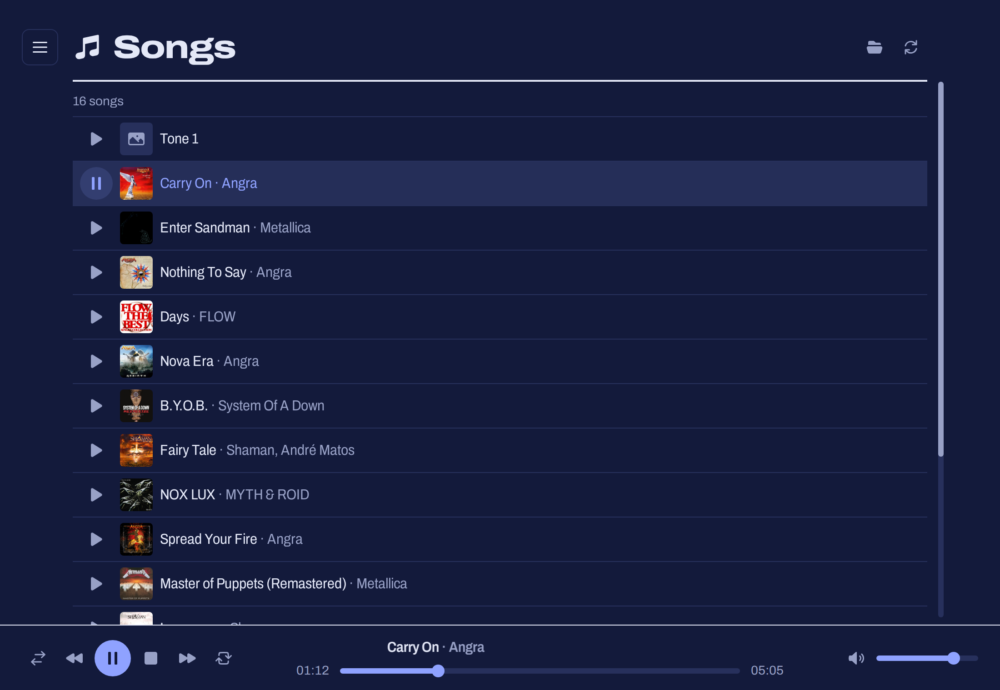

# Chopi

Chopi is a music player for Windows and Linux. Install it on Windows like any other app, or run it
portable on Windows and Linux, with nothing to install: from any folder of your computer, a flash
drive or an external disk. Either way, it keeps your songs, playlists and settings in its own
folder.

"Chopi" is an onomatopoeia in Guarani, an Indigenous language spoken in Brazil: it stands for the
song of the chopi blackbird, the bird on the app's icon.

<p align="center">
  
  
</p>

## Using Chopi

### Features

- Install it on Windows, or run it portable on Windows and Linux, from any folder or drive
- Supports MP3, M4A, AAC, Opus, Ogg, FLAC and WAV songs
- Gapless playback, with no silence between songs
- Add songs by dropping files/folders on the app window
- Playlists: create, edit, reorder and delete them
- Shuffle, repeat, volume and seeking
- Keyboard shortcuts, media keys and the system's media controls
- Remembers the player's state between launches
- Automatic update checks that can be turned off
- Dark theme

### Download

Get the files of the [latest release](https://github.com/NathanMBR/chopi/releases/latest), installed
or portable:

| System | Installed | Portable |
|---|---|---|
| Windows 10 or 11 | `chopi_<version>_windows_x64-setup.exe` | `chopi_<version>_windows_x64-portable.exe` |
| Linux | None (yet) | `chopi_<version>_linux_x64-portable`, or the AppImage, `chopi_<version>_linux_amd64.AppImage` |

- **Installed**: the setup installs Chopi for your user, without administrator rights, like any
  other app, and installs its updates for you.
- **Portable**: nothing to install. Put the file in any folder, on your computer, a flash drive or
  an external disk, and run it from there. Move or copy the folder, and Chopi goes along with your
  songs, playlists and settings. Its updates open in your browser, where you download the new file.
- On Linux, allow the file to run first: `chmod +x chopi_*`. It needs a system as recent as
  Ubuntu 22.04, with WebKitGTK 4.1 installed, as most desktop distributions have it.
- On Windows, the files aren't code-signed, so SmartScreen may warn about them: choose **More info**,
  then **Run anyway**.

> [!TIP]
> Give the portable Chopi a folder of its own, like `Chopi`, and run it from there: it creates its
> folders and files next to it, the `Songs`, `Playlists` and `Logs` folders and `settings.json` (see
> [Your files](#your-files)).

### Your files

Chopi keeps everything in the folder of its executable: the folder you put a portable Chopi or its
AppImage in, or `%LOCALAPPDATA%\Chopi` when the setup installed it. Uninstalling leaves them there.

| Next to the executable | What it holds |
|---|---|
| `Songs/` | Your songs, right inside it: Chopi doesn't look in its subfolders |
| `Playlists/` | One `.json` file per playlist |
| `settings.json` | The theme, the songs' order, the update checks and the player's state |
| `Logs/` | What happened in the last sessions, to send along with a bug report |

Put the portable Windows and Linux executables in the same folder, as on a flash drive, and both
share the same songs, playlists and settings.

### How to use

- **Add songs** by copying them into the `Songs` folder, or by dropping files or folders on the
  window, which copies the songs inside them into it. If you copied them while Chopi was open,
  click **Scan again** on the Songs page.
- **Play** a song with the button on its row. The player at the bottom has shuffle, repeat, the
  volume and the song's progress, where a click jumps.
- **Playlists**: open the menu at the top left and choose **Playlists**. The **+** button creates
  one, and each playlist's menu edits or deletes it. On a playlist's page, drag a song's handle to
  reorder it.
- **Settings**: from the same menu, choose the songs' order and whether Chopi checks for updates
  when it opens. The theme switch is at the bottom of the menu.
- **Updates**: when a new version is out, the menu shows **Update**, with its changes. An installed
  Chopi installs it; a portable one opens its download in your browser.

### Keyboard shortcuts

They work while a song is in the player, and each button's tooltip names its keys.

| Keys | Action |
|---|---|
| Space | Pause or resume |
| ← / → | Jump 5 seconds back or forward |
| ↑ / ↓ | Turn the volume up or down |
| Ctrl+← / Ctrl+→ | Previous or next song |
| Ctrl+X | Stop |
| S | Shuffle |
| R | Repeat mode |
| M | Mute |

## Chopi for Developers

Chopi is built with [Tauri 2](https://v2.tauri.app/), React 19 and TypeScript, styled with
Tailwind CSS. Songs are decoded and played in Rust, with `symphonia` and `cpal`.

### Requirements

- [Node.js](https://nodejs.org/) 24 and [pnpm](https://pnpm.io/) 10
- [Rust](https://www.rust-lang.org/tools/install), stable
- Tauri's [system dependencies](https://v2.tauri.app/start/prerequisites/) for your OS. On Debian or
  Ubuntu, they're these, with ALSA's headers, which the player's audio output needs:

  ```bash
  sudo apt-get install \
    libwebkit2gtk-4.1-dev \
    build-essential \
    libxdo-dev \
    libssl-dev \
    libayatana-appindicator3-dev \
    librsvg2-dev \
    libasound2-dev
  ```

### Setup

```bash
git clone https://github.com/NathanMBR/chopi.git
cd chopi
pnpm install
pnpm exec playwright install chromium   # the browser the story tests run in
```

### Commands

| Command | What it does |
|---|---|
| `pnpm tauri dev` | Runs the app in development mode |
| `pnpm tauri build` | Builds the release executable, the installer and the AppImage |
| `pnpm dev` | Runs only the interface in a browser, without the Rust side |
| `pnpm storybook` | Opens Storybook, the documentation of the interface, on port 6006 |
| `pnpm lint` | Type-checks, then lints and formats, applying safe fixes |
| `pnpm test` | Runs every test: TypeScript, then Rust |
| `pnpm test:ts` | Runs the TypeScript unit tests and the story tests |
| `pnpm test:rs` | Runs the Rust tests |
| `pnpm test:watch` | Runs the TypeScript tests in watch mode |
| `pnpm test:report` | Runs every test and writes reports to `private/test-report/` (needs `cargo install cargo-nextest --locked`) |

In development, the executable is `src-tauri/target/debug/chopi`, so its `Songs`, `Playlists` and
`Logs` folders are in `src-tauri/target/debug/`.

### Documentation

- [`AGENTS.md`](./AGENTS.md): the project's architecture, conventions, testing and release steps
- Storybook (`pnpm storybook`): every component, with its stories and design tokens
- [`docs/technical-decisions/`](./docs/technical-decisions/): why parts of the app are built the
  way they are
- [`docs/changelog/`](./docs/changelog/): the patch notes of each release

### Recommended IDE setup

[VS Code](https://code.visualstudio.com/) with the
[Tauri](https://marketplace.visualstudio.com/items?itemName=tauri-apps.tauri-vscode) and
[rust-analyzer](https://marketplace.visualstudio.com/items?itemName=rust-lang.rust-analyzer)
extensions.

## License

[MIT](./LICENSE)
